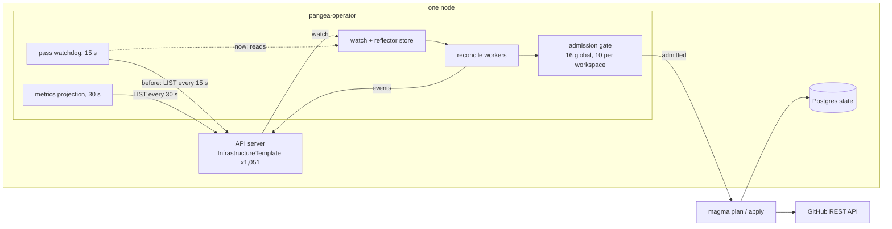
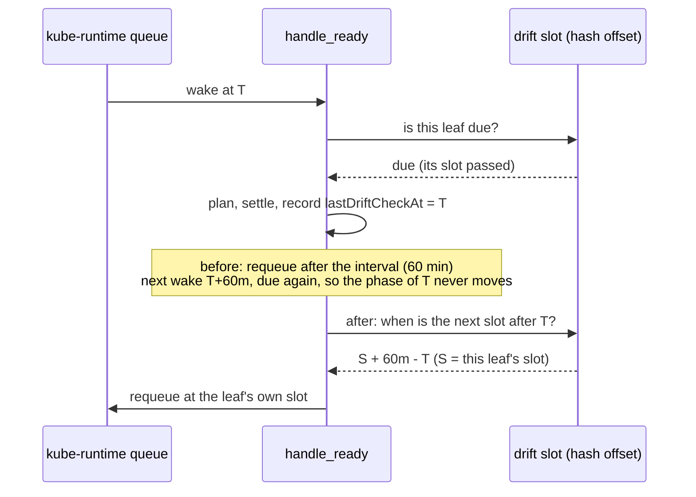
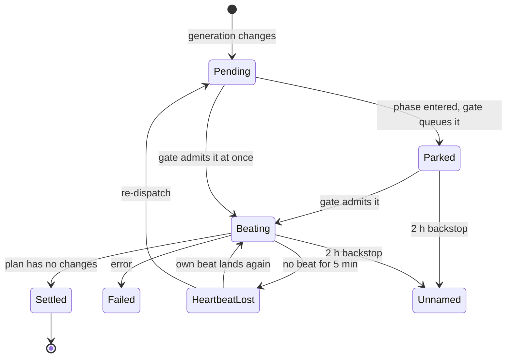

# Performance and resilience — where a pass spends its time, and what fails

This doc measures how the operator spends time and where it fails while it
reconciles about 1,050 templates on one node. It ranks the levers by evidence,
records the decisions, and keeps a tier ledger. `LEAVES.md` owns the leaf model
and the admission gate. This doc points at those sections and does not restate
them.

---

## 1. Destination

A change to one leaf reaches the provider in the time of its own plan and
apply, whatever the other 1,049 templates do. A restart costs only the passes
it interrupted. Background work (drift checks) runs at a flat rate that the
node and the provider's rate limit can carry. A transient fault (DNS, a 5xx, a
rate limit) delays a pass and never fails it. Every wait is a named, visible
state, never a false stall. The operator reads cluster state from its own watch
cache and does not list the whole fleet on a timer.

The world-facts that limit it:

- GitHub's REST rate limit for one installation token. A drift plan refreshes
  each resource with a live read.
- One node: CPU, RAM and swap are shared with a desktop session, a VM and a
  local model server.
- A provider call has network latency that no scheduling removes.

Everything else in this doc is ours to change.

## 2. Ground (measured 2026-11-11, one node, 13:30 UTC)

Sources: the operator's own log since its 08:13:41Z start (110,517 lines,
5 h 13 min), the live `InfrastructureTemplate` objects (`kubectl get it -A -o
json`, 1,051 objects, 20 MB), VictoriaMetrics series `pangea_*`, and `ps` on the
node.

| Fact | Value | Source |
|---|---|---|
| Templates | 1,051: 1,048 Ready, 1 Planning, 1 Pending, 1 Drifted | live objects |
| Leaves with `refreshInterval: 60m` | 1,049 | live objects |
| Drift checks per hour | about 1,070 | `state saved` log lines per hour |
| Share of the hour's drift checks in one 20-minute window | 86% (920 of 1,070, every hour 08:20 to 12:40) | `state saved` lines per 10 min |
| `lastDriftCheckAt` in minutes 25 to 40 of the hour | 835 of 1,048 (80%) | live objects, 12:00 to 13:00 UTC |
| Reconcile caps | 16 global, 10 per workspace | operator config file |
| Phase p95 over 24 h | applying 118 s, planning 26 s, initializing 8.6 s, compiling 4.8 s | `pangea_reconciliation_duration_seconds` |
| Admission deferrals since start | 527 (217 Compiling, 305 Planning, 5 Applying) | `pangea_admission_deferred_total` and log |
| Restarts of the operator | 1 to 6 per day over 7 days | counter resets |
| Templates mid-cycle at the 08:13 start | 97 (Compiling) | `Updated template phase` log lines 08:18 to 08:19 |
| False `heartbeatLost` stalls after that start | 90 (08:24), each re-dispatched once | watchdog log |
| `orphanedPhase` stalls after that start | 15 | watchdog log |
| Events refused by the API server | every event: 692 of 692 since start | `event kept in the status ring` log lines |
| Refusal reason | `missing metadata.name in request body` (the server does not apply `generateName`) | same lines |
| Full template LIST | 2.5 s to 6.4 s, 20 MB as JSON | three timed `kubectl get it -A -o json` |
| Full template LISTs per minute by the operator | about 6.5: watchdog 4, metrics projection 2, fleet status 0.4, catalog 0.2 | code (`WATCHDOG_TICK` 15 s, projection `TICK` 30 s) and log counts |
| API server CPU | 75% of one core now, 29% mean over 5.7 days | `ps` on the node |
| Operator RSS | 279 MB | `ps` on the node |
| Template reconcile errors | 4,681 in 7 days; spikes of 594 and 664 in the hours of two restarts | `pangea_reconciliation_errors_total` |
| Errors in the current incarnation | 34, all `rolesAnywhere CreateSession` request failures (network) on 4 templates | log |
| GitHub rate-limit refusals | 0 | log |

What this ground does not show (blind, not zero):

- The operator's log does not reach VictoriaLogs. Only the live pod's log is
  readable, so the error classes before 08:13 today are unknown.
- Until bbfb1d0 (2026-11-11) the error counter carried no reason label, so
  the 4,681 errors have no breakdown. New errors carry `reason` and `name`.
- `pangea_leaf_plan_seconds` records change plans only (109 samples). Drift
  plans have no duration series.
- The API server exports no request metrics, so the LIST share of its CPU is
  derived from the LIST cost and rate, not measured.

## 3. Research

| Source | What it says | Adopt / adapt / skip |
|---|---|---|
| client-go event recorder (`tools/record/event.go`, `makeEvent`) | sets `metadata.name` to `<object>.<unix nanos in hex>`; it does not use `generateName` | adopt: the same name shape |
| controller-runtime and kube-runtime reflectors | a controller reads a watch-fed cache; a periodic LIST of the whole kind is the anti-pattern | adopt: the watchdog reads the controller's store |
| Kubernetes CronJob and the Prometheus scrape scheduler | spread periodic work by a stable hash offset inside the interval | already adopted by `pangea_leaf::drift` (`LEAVES.md`); this doc fixes the requeue that defeated it |
| AWS and Google retry guidance (full jitter, retry budget) | retry transient faults with capped exponential backoff and jitter | adapt later: §6, lever 6 |

## 4. States and trust

A pass is in one of these states. The table names who may assert each one and
how.

| State | Meaning | Asserted by |
|---|---|---|
| Settled | no work for this generation | the handler, after a plan with no changes |
| Pending | a generation waits for a pass to start | the watchdog's projection of `status` |
| Planning / Applying, beating | a pass runs and its heartbeat lands every 30 s | the pass's own heartbeat task |
| Planning / Applying, **parked** | the pass waits for an admission slot | the admission gate, which holds the template in its queue |
| Stalled: heartbeatLost | no heartbeat for 5 min and the gate does not hold it | the watchdog |
| Stalled: queuedBehind, orphanedPhase, noProgress, unnamed | as named in `pass.rs` | the watchdog |
| Failed | the pass ended with an error | the handler |
| Blind | the watchdog could not read the template (LIST failed or the store is not ready) | nobody: the tick concludes nothing |

The bad state this work removes: a parked pass reported as `heartbeatLost`. The
gate knows the template waits; the watchdog did not ask it. Now it asks, and a
parked pass counts as alive. The 2-hour backstop (`unnamed`) still applies to a
parked pass, so a pass that the gate never admits is still named.

## 5. Diagrams

### Context

### A drift check, before and after

### Pass lifecycle, with the parked state

## 6. Levers, ranked by evidence

Expected gains are estimates from the ground above, not measurements after the
change. §8 says how each one is checked once it is live.

| # | Lever | Evidence | Expected gain | State |
|---|---|---|---|---|
| 1 | Requeue a settled drift check to the leaf's own slot (`leaf.drift_to_slot`) | 86% of hourly drift checks in 20 min; the hash offsets exist but the `refreshInterval` requeue kept every leaf on the phase of the last restart | peak drift rate from about 46 to about 18 checks per minute; admission waits in that window fall to near 0; a change made in the window no longer queues behind about 900 drift plans | built |
| 2 | The watchdog reads the controller's reflector store, not a LIST (`reactive.watchdog_from_store`) | 4 LISTs per minute of 20 MB, each 2.5 s to 6.4 s, on an API server at 75% CPU | about 60% of the operator's full-fleet LIST traffic removed (4 of 6.5 per minute) | built |
| 3 | A pass parked at admission is alive (`reactive.parked_pass_alive`) | 90 false `heartbeatLost` stalls and 90 re-dispatches in the 5 min after one restart | 0 false stalls per restart; no re-dispatch churn in the gate's queue | built |
| 4 | Events carry an explicit name | 692 of 692 events refused by the API server since start | events reach `kubectl get events` again; the status ring stays as the fallback | built |
| 5 | The metrics projection reads the store too | 2 LISTs per minute of 20 MB | the other 30% of the LIST traffic | next: same shape as lever 2, in `observability/projection.rs` |
| 6 | Classify transient faults (DNS, connect, 5xx, rate limit) as blind and back off with jitter | 34 errors in 5 h, all one network class; the DNS outage today failed the token mint CronJob | fewer `Failed` passes and less error-policy churn in an outage | next: read a day of the new `reason` label first |
| 7 | Warm restart of mid-cycle templates | 97 templates re-ran Initializing and Compiling after one restart | about 10 min of compile and plan work saved per restart | next: measure how many restarts land mid-cycle before building |
| 8 | Ship the operator log to VictoriaLogs; label errors by class | the error classes before the current start are unknown | turns the blind rows of §2 into measurements | labels: done in bbfb1d0; log shipping: next, in the node's log shipper config |
| 9 | Memory caps | operator RSS 279 MB; the node's swap is full from other tenants | no evidence that the operator causes the pressure | rejected for now |

## 7. Decisions

1. **The drift slot owns the requeue, not the interval.** Alternative rejected:
   add random jitter to the interval. Jitter spreads one sweep but drifts
   again and loses the stable per-leaf slot that the gate and the dashboards
   already use. The slot is deterministic and already computed.
2. **The watchdog reads the store that the controller already keeps.**
   Alternative rejected: a second watch for the watchdog. That doubles the
   watch traffic for no new information. The store is fed before the
   generation filter, so it carries status writes too. If the store is not
   ready (writer dropped), the watchdog lists as before.
3. **A parked pass beats in the projection only.** The beat is not written to
   `status`: the projection patch writes `pass` only when its kind changes, so
   the change adds no API writes. Alternative rejected: write a heartbeat on
   each admission denial. That adds a status write per denial (527 in 5 h).
4. **Events use a client-side name.** Alternative rejected: teach the API
   server `generateName` first. That is a correct fix in the server, but the
   client-go shape works on both kinds of server, so the operator does not
   wait on it. The server gap stays open (§9).
5. Each lever has a switch, default on, that restores the old behaviour:
   `leaf.drift_to_slot` (`PANGEA_LEAF_DRIFT_TO_SLOT`),
   `reactive.watchdog_from_store` (`PANGEA_WATCHDOG_FROM_STORE`),
   `reactive.parked_pass_alive` (`PANGEA_PARKED_PASS_ALIVE`). The bare
   configuration turns the two `reactive` switches off. Event naming has no
   switch: the old shape produced no events on this server, so no behaviour is
   lost.

## 8. How each lever is checked once live

- Lever 1: `lastDriftCheckAt` minute histogram (the §2 query) is flat after
  one hour: no 5-minute bucket holds more than about 2x its share (87).
- Lever 2: the watchdog start line says `from_store: true`; API server CPU
  (`ps`) falls.
- Lever 3: after the next restart, `template pass stalled ... heartbeatLost`
  lines are 0 while `admission denied` lines are not.
- Lever 4: `event kept in the status ring` lines are 0 and `kubectl get events
  -n default` lists operator events.

## 9. Open questions

| Question | Kind |
|---|---|
| Does the API server implement `generateName` on create? It refuses it today. | ours (the API server is ours to fix) |
| What share of drift-plan time is GitHub latency versus local work? | ours (needs a drift-plan duration series) |
| How many GitHub requests does one drift plan make? | ours (needs a per-plan request count) |
| What is the installation token's hourly budget under the flat drift rate? | world-fact (GitHub's limit), measurable from response headers |

## 10. Tier ledger

| Item | Design | Exists | Tested | Live |
|---|---|---|---|---|
| Lever 1, drift requeue to slot | ✅ | ✅ `leaf::drift_requeue_after_check`, `settled_requeue` | ✅ 1,042-leaf, 3-hour simulation; red with the switch off | ⏳ after the node rebuild |
| Lever 2, watchdog from store | ✅ | ✅ `pass_driver::watched_templates` | ✅ store read lists nothing; off lists as before | ⏳ after the node rebuild |
| Lever 3, parked pass alive | ✅ | ✅ `pass::project_status_parked` | ✅ parked is Planning, unparked is heartbeatLost, backstop still fires | ⏳ after the node rebuild |
| Lever 4, event names | ✅ | ✅ `event_sink::event_name` | ✅ a mock server that refuses `generateName` accepts the event | ⏳ after the node rebuild |
| Levers 5 to 8 | ✅ | ➖ | ➖ | ➖ |

Mutation check (`cargo mutants` over the new functions, 2026-11-11): 31
mutants, 15 caught, 10 missed, 6 unviable on the first pass. The misses were
the wiring around the pure functions. After `drift_requeue_with`, `parked_at`
and `ready_store` were split out and tested, the second pass over that wiring
gave 19 mutants, 10 caught, 7 unviable, 2 missed. The 2 misses are both in
`parked_at_admission`, a one-line seam that needs a full `ControllerState`.
